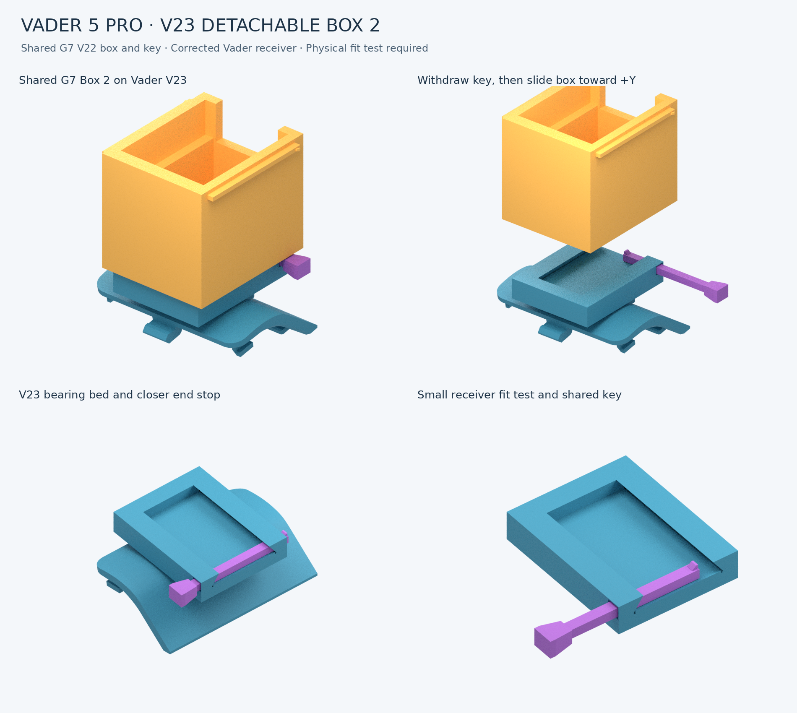

# Vader 5 Pro detachable Box 2 mount — V37 extended shell and catch lips

**Latest:** [V37 small PLA cover test](print/v37_pla/Vader5Pro_V37_PLA_Extended_Shell_Catch_Lips_Test.3mf) adds 3 mm to the catch-lip overhang without deeper hook legs, and 3 mm to the main lower shell edge. Shell is now 35 × 24 mm; the reinforced middle tongue moves with the rim. [All parts on one plate](print/v37_pla/Vader5Pro_V37_All_Parts_One_Plate_PLA.3mf) · [Direction diagram and print instructions](print/v37_pla/README.md). Physical fit remains unverified.

## V36 — previous extension trial

**Latest:** [V36 small PLA cover test](print/v36_pla/Vader5Pro_V36_PLA_Longer_Anchored_Hooks_Test.3mf) adds 0.30 mm top-hook reach and 0.50 mm middle-tongue reach, with a full-width tapered anchor web into the shell. Shell dimensions stay 35 × 21 mm; overall height becomes 26.5 mm. [All parts on one plate](print/v36_pla/Vader5Pro_V36_All_Parts_One_Plate_PLA.3mf) · [Changes and side-print instructions](print/v36_pla/README.md). Physical fit and strength remain unverified.

## V35 — previous wider-hook trial

**Latest:** [V35 small PLA cover test](print/v35_pla/Vader5Pro_V35_PLA_Wider_Hooks_Test.3mf) widens the opposite-edge hooks to 6 mm, increases necks to 1.6 mm and adds larger braces while keeping tip reach and insertion depth. [All parts on one plate](print/v35_pla/Vader5Pro_V35_All_Parts_One_Plate_PLA.3mf) · [Changes and side-print instructions](print/v35_pla/README.md). Physical clearance, retention and strength remain unverified.

## V34 — previous reinforced hook trial

**Latest:** [V34 small PLA cover test](print/v34_pla/Vader5Pro_V34_PLA_Reinforced_Hooks_Test.3mf) gives the opposite-edge pair deeper retaining shoulders, thicker necks and root gussets. Cover and mount print on their sides for clearer hook contours. The measured shell and middle clip remain. [All parts on one plate](print/v34_pla/Vader5Pro_V34_All_Parts_One_Plate_PLA.3mf) · [Changes and print instructions](print/v34_pla/README.md). Fit and strength remain physically unverified.

## V33 — previous measured cover

**Latest:** [V33 small PLA cover test](print/v33_pla/Vader5Pro_V33_PLA_Measured_Cover_Test.3mf) targets the owner's 35 × 21 mm shell, 5 × 5 mm middle clip and 26 mm overall. Top clips use an explicitly stated assumption of 4 mm inward reach. [All parts on one plate](print/v33_pla/Vader5Pro_V33_All_Parts_One_Plate_PLA.3mf) · [Changes and limits](print/v33_pla/README.md). Physical fit remains unverified.

## V32 — previous hook-profile trial

**Latest:** [V32 test cover](print/v32_pla/Vader5Pro_V32_PLA_Reshaped_Hooks_Test.3mf) rebuilds the top-hook ends with flat retaining ledges and beveled entry edges, keeping the improved middle tongue. [All functional parts on one plate](print/v32_pla/Vader5Pro_V32_All_Parts_One_Plate_PLA.3mf) · [Changes, settings and limits](print/v32_pla/README.md). Physical retention remains unverified; start with the test cover.

## V31 — previous length trial

**All parts in one print:** [V31 one-plate PLA 3MF](print/v31_pla/Vader5Pro_V31_All_Parts_One_Plate_PLA.3mf) arranges the full mount, Box 2 and sliding lid with supports on one U1 plate, printed by layer. Open as a project in Snapmaker Orca.

**Latest:** [V31 single-cover PLA test](print/v31_pla/Vader5Pro_V31_PLA_Larger_Top_Clips_Test.3mf) adds another 0.20 mm of top-hook toe reach after V30 felt better but still released. The improved middle tongue and print settings remain. [Matching complete project and instructions](print/v31_pla/README.md). Physical retention remains unverified.

## V30 — previous top-clip trial

 [V30 single-cover PLA test](print/v30_pla/Vader5Pro_V30_PLA_Larger_Top_Clips_Test.3mf) adds 0.20 mm reach to both top-hook toes while retaining V29’s improved middle tongue. [Matching complete project and instructions](print/v30_pla/README.md). Start with the small test; physical fit remains unverified.

## V29 — previous middle-clip trial

 [V29 single-cover PLA test](print/v29_pla/Vader5Pro_V29_PLA_Longer_Middle_Clip_Test.3mf) extends V28 B’s middle clip by 0.40 mm along its existing reach direction. [Matching complete project and details](print/v29_pla/README.md). Print the small cover first; physical seating remains unverified.

## V28 — previous PLA version

**Material: regular Snapmaker black PLA.** [V28 PLA cover-test project](print/v28_pla/Vader5Pro_V28_Snapmaker_PLA_Black_Cover_Tests.3mf) · [Complete PLA project and settings](print/v28_pla/README.md). Configured for Snapmaker Orca / U1 / 0.4 mm, 220°C nozzle, 65°C textured PEI bed, 0.12 mm layers, custom supports and brims. Geometry is unchanged from V28; physical PLA fit remains unverified.

## V28 — PETG version

 [V28 small cover tests](print/v28_seating/Vader5Pro_V28_Underside_Clearance_Tests.3mf) add 0.15/0.30 mm of controller-facing shell clearance after the owner reported the cover still sits high. Both retain V26 A hook geometry and V27 printing aids. Print plate 1 / A first. [Complete project, changes and limits](print/v28_seating/README.md). Physical seating remains unverified.

## V27 — printing recovery

 [V27 cover-test print recovery 3MF](print/v27_print_recovery/Vader5Pro_V27_Cover_Tests_Print_Recovery.3mf), with a 5 mm contacting brim, closer custom supports and a warmer first-layer bed after a reported failed print. Part geometry is unchanged from V26. [Complete project and instructions](print/v27_print_recovery/README.md). Physical printing reliability remains unverified.

## V26 — retention geometry trials

[V26 small cover fit-test 3MF](print/v26_retention/Vader5Pro_V26_Cover_Fit_Trials_Only.3mf). The shell is relieved another 0.25 mm and two variants increase local retaining-lip engagement. Start with **cover A, plate 1** before printing a full mount. [Complete seven-plate project](print/v26_retention/Vader5Pro_V26_Retention_Trials_Complete.3mf) · [Settings, changes and fitting instructions](print/v26_retention/README.md).

V25 was reported to seat better but release under a slight backward pull. V26 is a retention trial; physical fit and removal force remain unverified. No exact OEM drawing is available.

## V25 — previous seating trial

[V25 seating and PETG quality project](print/v25_quality/README.md) introduced exterior/rim relief and separate plates. V26 retains its PETG quality settings and box/lid geometry.

## V24 — previous revision

**Archived PETG project:** [Download V24 for Snapmaker U1 / IEMAI matte black PETG](print/v24_iemai_petg/Vader5Pro_V24_U1_IEMAI_Matte_PETG_Complete.3mf). It includes the corrected box, a matching sliding cap, thinner/longer controller clips, custom supports and a controller-cover fit piece. The separate locking key is removed. [Settings, fitting and support-removal instructions](print/v24_iemai_petg/README.md).

V24 keeps the current box opening size and extends its 20 × 24.5 mm cavity down to the floor. The original male rail stays compatible with the supplied G7 interface. Clip changes and PETG settings still need a physical fit/print trial.

## Previous V23 release — archived

A replacement V2 mounting cover with a slide receiver for the **same detachable G7 Pro V22 Box 2**. Move the box between controllers without changing its enclosure or male rail. Both Box 2 and the removable key are byte-for-byte copies of the supplied G7 parts.

**Snapmaker U1 print project:** [Download the complete black PLA / 0.4 mm 3MF](print/u1_black_pla/Vader5Pro_V23_U1_Black_PLA_Complete.3mf), with saved printer/material settings, oriented parts, custom peelable supports, a spare key and fit-test receiver. [Print and removal instructions](print/u1_black_pla/README.md).

**Status: mesh-checked prototype; physical Vader fit still needs testing.** The V2 cover came from another maker and is reported to fit by the user. No measured controller interface or controller CAD was supplied. The original cover's controller-facing geometry is preserved within STL export precision; this does not independently prove controller fit.



## Files to print

| File | Purpose |
| --- | --- |
| [Vader5Pro_V23_Mount.stl](print/Vader5Pro_V23_Mount.stl) | V2 cover plus corrected receiver, printed as one part |
| [Box 2.stl](print/Box%202.stl) | Shared detachable G7 V22 box; reuse your existing box |
| [G7_V22_Lock_Key.stl](print/G7_V22_Lock_Key.stl) | Shared G7 V22 removable key |
| [Vader5Pro_V23_Three_Parts.3mf](print/Vader5Pro_V23_Three_Parts.3mf) | Three separate objects arranged on the bed; geometry only, no printer settings |
| [Vader5Pro_V23_Receiver_Fit_Test.stl](print/Vader5Pro_V23_Receiver_Fit_Test.stl) | Small standalone receiver to test with your existing G7 box and key first |

All dimensions are millimeters. Import at **100% scale**. STLs retain their design coordinates; use your slicer's “drop to bed.” The 3MF places all three parts at Z=0 and keeps them separate.

## Corrections from V22

Only the Vader receiver changes. The original G7 box, key, cover clips, external bridge, and receiver key tunnel are retained.

- Raised the rail's bearing bed by **0.41 mm**. The bed now supports the rail at a seating height that gives **0.25 mm** between the receiver lip and box floor, versus V22's nominal 0.07 mm. This also leaves **0.16 mm** above the key tab and avoids using that tab to support the box.
- Relieved each internal dovetail flank by **0.20 mm horizontally** to accommodate the higher rail position. The tightest nominal side gap is approximately **0.265 mm horizontally / 0.215 mm normal to the flank**.
- Extended the closed end stop by **2.30 mm**, reducing nominal fore/aft play from **2.80 mm to 0.50 mm** with the key installed. There is 0.25 mm clearance at each rail end in the reference pose.
- Rebuilt both assembly previews and the three-object 3MF from the corrected geometry.

## First print and assembly

1. Print the small receiver fit test. With the key removed, try your existing G7 Box 2. It should slide by hand and remain captured vertically by the dovetail. Test both 180° orientations.
2. Insert the key laterally through the paired slots at the open end. The original key includes a small flexible retention detent. It must flex while passing the side wall; do not force a rigid or brittle print. Confirm that the installed key blocks the box from sliding out.
3. Print and test the **original V2 cover alone** if its controller fit has not already been established. This isolates controller-clip fit from receiver fit. The archived original is [here](originals/Vader5Pro_Original_V2_Cover.stl).
4. Print the complete V23 mount. Fit it in place of the controller's removable mounting cover, then attach Box 2 and the key. Check the controller buttons, paddles, switches and cable path on your actual controller.
5. To detach, release and withdraw the key sideways, then slide the box out through the open end. Rotate the box 180° in the mounting plane to reverse its USB opening and slide it back in. The enclosure opening remains outward.

In the CAD coordinate system the **open end is +Y**; the closed stop is −Y. Enter from +Y and slide toward −Y. Withdraw toward +Y. The key pulls toward +X from its larger handle. The USB up/down preview names follow the supplied V22 convention.

PETG is a reasonable starting material for the cover and key. Use a calibrated printer, around 0.16–0.20 mm layers and at least four walls. Verify supports in the slicer: the complete mount has downward clips, and the box has a projecting underside rail. The supplied bed layout is not a support preset. Keep support scars off clips, dovetail flanks and key slots. Do not rescale the shared box to tune the fit; adjust `side_relief` in the Vader receiver source instead. Print the fit test again after adjustments.

## Validation and source

[Validation report](validation/VALIDATION.md) · [Machine-readable results](validation/results.json) · [Editable OpenSCAD](source/Vader5Pro_V23.scad) · [USB down inspection GLB](preview/V23_USB_Down.glb) · [USB up inspection GLB](preview/V23_USB_Up.glb)

To reproduce the exports and checks, install OpenSCAD and Python dependencies, then run:

```sh
python -m pip install -r tools/requirements.txt
python tools/build_validate.py
```

The PNG preview can also be regenerated with Blender 4.x and Pillow installed: `python tools/render_preview.py`. The GLB inspection files are generated by the main build script.

All supplied ZIP contents are preserved under [`originals/`](originals/), including the older V22 previews, claims and print layout. **Use `print/` for V23; `originals/` is an archive.** Original maker attribution and redistribution terms were not supplied; this repository does not claim authorship or grant a new license for the imported cover or G7 parts.

## Printable measuring aid

[80 mm sliding caliper R2 — looser replacement slider and complete U1 PLA project](print/printable_caliper_v2/README.md). Two-piece slider plus check gauge; 1 mm markings. Useful for rough measurements, with accuracy checked against a real ruler. It does not establish submillimeter OEM hook dimensions.
