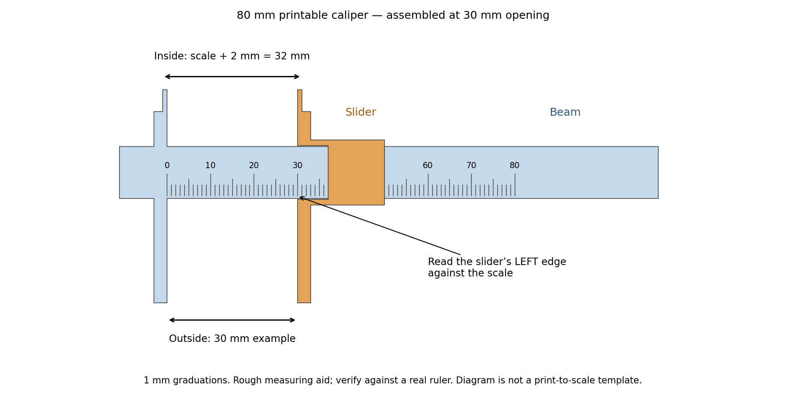

# Printable 80 mm sliding caliper — U1 black PLA

[Download one-plate 3MF](Printable_Caliper_80mm_U1_Black_PLA.3mf) · [Beam STL](Caliper_Beam.stl) · [Slider STL](Caliper_Slider.stl) · [Check gauge STL](Check_Gauge_40_20.stl) · [Editable OpenSCAD](../../source/printable_caliper/Caliper_80mm.scad)

An original two-piece sliding measuring aid for rough controller-cap dimensions. Range **0–80 mm**, engraved **1 mm graduations**, outside jaws and inside tips. No screws or other hardware. The included third piece is a printed check gauge.

**This is not a precision caliper.** Graduation spacing does not establish accuracy. Printer scale, flow, slider play, jaw flex and brim cleanup affect results. It is useful for approximate width/depth and comparisons; do not treat it as proof of submillimeter OEM hook tolerances. A digital caliper is the better tool for those dimensions.

## Printing

Open the 3MF **as a project** in Snapmaker Orca. All three pieces print together on one U1 plate. Map the filament to regular Snapmaker black PLA in the selected tool. Keep 100% scale and saved orientations.

Saved setup: U1 0.4 mm nozzle, textured PEI, 220°C nozzle / 65°C bed, 0.12 mm layers after a 0.20 mm first layer, four walls, 35% gyroid and 3 mm brims. Automatic supports are off. The slider has a short 12.4 mm roof bridge; remove loose bridge strands from the channel, if any, rather than inserting supports. Estimated **1h 38m**, **10.81 g**. These are slicer estimates; physical printing is untested.

## Assembly

1. Allow the pieces to cool and remove all brims. Clean the jaw faces and the slider channel carefully without rounding the measuring edges.
2. Feed the **free right-hand end of the beam** through the slider's channel. Keep both sets of outside jaws on the same side, facing each other, and the inside tips on the opposite side. The moving jaw must face the fixed jaw. Slide toward zero.
3. Close the outside jaws gently. The slider's **left/front edge at the moving jaw** should align with the zero tick. Read that edge against the **left edge of each engraved scale groove** consistently. Do not use the back edge of the 20 mm-wide slider.
4. If the slider binds, remove rough bridge strands and lightly deburr the channel. Do not force it over the beam or file the scale/jaw faces to make it fit. The design has 0.20 mm clearance around the beam, but a tight print may require channel cleanup. The slider has no lock or end stop; hold it steady while reading.

## Measuring and checking

- **Outside:** close the lower jaws lightly around the part and read the scale. Avoid flexing the thin jaws.
- **Inside:** insert the two upper tips, spread them gently to contact opposite walls, then **add 2 mm to the scale reading**. Each inside tip is 1 mm thick; their outer faces are 2 mm apart at zero. For example, scale 18 means an inside dimension of 20 mm. The beam is marked `IN +2`.
- First compare several openings against a real millimeter ruler, such as 20, 40 and 60 mm. Record any consistent zero offset. If errors change with opening or gentle pressure, do not use the tool for fitting decisions.
- The printed gauge has a nominal 40 mm outside width, 20 mm outside height and a 20 mm inside opening. It helps check zero/reading technique and repeatability. **It cannot independently calibrate printer scale**, because the gauge and caliper share the same printer errors. Check it against a real ruler or another known dimension.

Physical accuracy, slider fit and jaw stiffness are unverified. The photo and diagram comparisons should still include a real ruler when possible.

[Mesh and 0–80 mm clearance checks](../../validation/printable_caliper/geometry_checks.json) · [Native one-plate/settings checks](../../validation/printable_caliper/native_project_checks.json) · [Independent Orca slice and extrusion bounds](../../validation/printable_caliper/slice_result.json)
