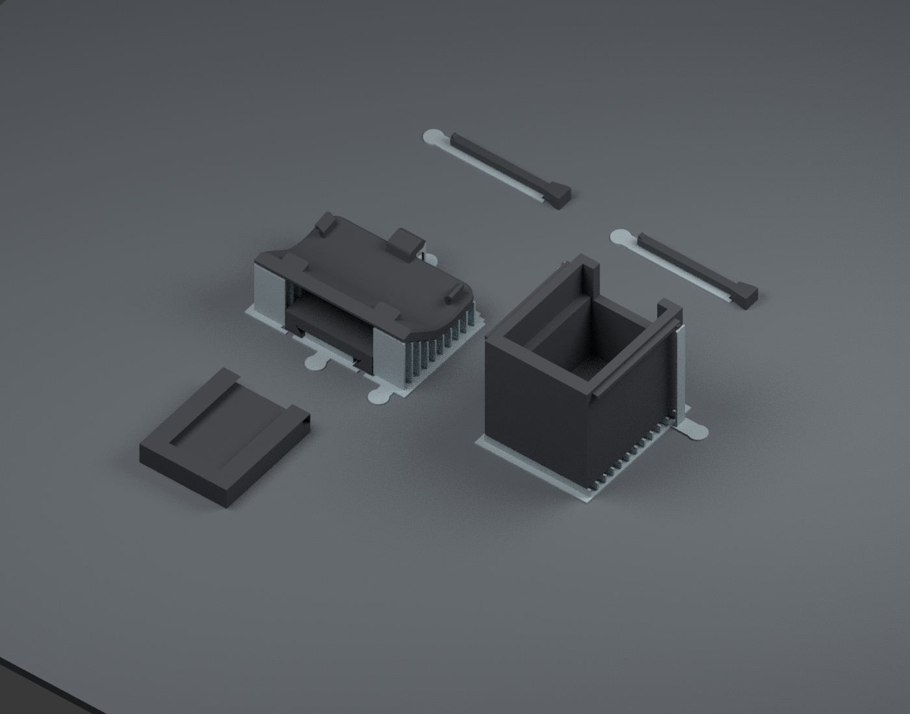

# Snapmaker U1 · regular black Snapmaker PLA · 0.4 mm nozzle

Open **[Vader5Pro_V23_U1_Black_PLA_Complete.3mf](Vader5Pro_V23_U1_Black_PLA_Complete.3mf) as a project** in Snapmaker Orca. Choose **Open Project**, rather than importing geometry only, to retain the settings and support assemblies.

One plate contains the V23 Vader mount, the unchanged shared G7 Box 2, two unchanged G7 keys (one spare), and the receiver fit-test piece. All parts and custom supports use **one black PLA filament**. Map that filament to the U1 tool containing your regular black Snapmaker PLA, then **Slice Plate** and review Preview before printing. No support filament or other material is needed.



Gray in this illustration identifies sacrificial supports only. Everything prints in black PLA.

## Embedded settings

| Setting | Saved value |
| --- | --- |
| Printer | Snapmaker U1, 0.4 mm nozzle |
| Filament | Regular Snapmaker PLA Basic, black; based on official U1 preset |
| Bed | Textured PEI Plate, 65°C |
| Nozzle | 220°C, first and subsequent layers |
| Layer / first layer | 0.16 / 0.20 mm |
| Walls / top / bottom | 4 / 6 / 5 layers |
| Infill | 25% gyroid |
| Outer / inner wall speed | 40 / 70 mm/s |
| First layer / bridge speed | 20 / 25 mm/s |
| Volumetric flow limit | 10 mm³/s |
| Automatic supports / raft / purge tower | Off |
| Brim | Off globally; 2 mm removable brim on each key only |
| Complete plate estimate | About 1 h 42 min and 19 g, including supports and spare key |

The temperature values follow the PLA Basic U1 preset bundled with Snapmaker Orca 2.4.1. Flow, cooling and adhesion can still need tuning for an individual spool or plate. Keep the saved 100% scale and orientations; the shared box and keys have not been resized or redesigned.

## Orientations and custom supports

- **Mount:** receiver lips toward the bed, controller clips facing up. This keeps the clips off support interfaces. Four removable support sections carry the overhanging cover and channel roof. Three thin angled arms support the original cover tab above the closed receiver end.
- **Box 2:** upright, rail down. A shallow removable frame supports the floor around the rail. Two narrow blades support the original tiny rim-retention hooks; the rest of the rim has no tall support cage.
- **Keys:** flat on small peelable carriers. A separate brim stabilizes each small handle footprint.
- **Fit-test receiver:** flat on its base, without support.

The custom supports are actual modeled parts, named **PEEL OFF custom supports** inside each object. They must remain enabled for printing. Their thin comb ribs are 0.44 mm wide, on 2.4 mm centers, with a 0.36 mm base and exposed pull tabs. Most contact gaps are designed at **at least 0.24 mm**, with layer alignment making some gaps larger. They are separate sacrificial solids, not fused into the finished STL geometry. Leave automatic support generation off.

## Removal

1. Let the plate cool, flex the PEI sheet, and lift the objects gently.
2. Hold the mount by its broad cover or receiver. Peel the exterior support bases using their tabs. Withdraw the central receiver comb through the **open end of the slide channel**. Remove the thin angled tab-support arms gently; avoid levering against the controller clips.
3. On Box 2, flex the two narrow rim-support blades outward to free them from the tiny hooks. Pull the shallow floor-support frame down and off the male rail. Grip the support frame rather than the hooks.
4. Hold each key by its handle and peel off the carrier and brim. Avoid bending the retention detent while cleaning it.
5. Remove loose strands from the rail and slots, then test the box and key in the small receiver before fitting the controller mount.

These are designed for easy separation, but removal force and surface finish have **not been physically tested**. In PLA, avoid forcing the small snap features. The controller-fit limitations of the main V23 design still apply.

## Verification and slicer notices

The saved native 3MF was reopened in Snapmaker Orca 2.4.1 and sliced. Its settings, five object groups, nine positive volumes, 100% part geometry and support clearances are checked separately by `tools/validate_u1_project.py`. See [project checks](../../validation/u1_black_pla/project_checks.json), [support geometry](../../validation/u1_black_pla/support_geometry.json), [layer island checks](../../validation/u1_black_pla/layer_islands.json), and [slicing results](../../validation/u1_black_pla/slice_result.json).

Orca may warn about **floating regions/cantilevers** because the manually modeled supports deliberately stop short of the part. Those warnings were retained, not suppressed. The independent layer check verifies that each newly appearing region larger than 0.03 mm² projects onto material within the preceding three layers, using a 0.15 mm XY tolerance. This checks the deliberate support gaps; it is not a physical print test or a guarantee of printer adhesion.

## Rebuilding

Install `tools/requirements-u1.txt`. Run:

```sh
python tools/build_u1_project.py
python tools/check_u1_layers.py
```

Then use the Snapmaker Orca executable (substitute its path for `snapmaker-orca`):

```sh
snapmaker-orca --allow-newer-file --arrange 0 --orient 0 \
  --load-settings 'source/u1_black_pla/U1_0p4_machine.json;source/u1_black_pla/U1_precision_process.json' \
  --load-filaments source/u1_black_pla/Snapmaker_PLA_Black.json \
  --export-3mf print/u1_black_pla/Vader5Pro_V23_U1_Black_PLA_Complete.3mf \
  source/u1_black_pla/U1_Oriented_Seed.3mf
python tools/validate_u1_project.py
```

The `--allow-newer-file` flag works around the release's CLI reporting an older internal version than its own exported 3MF application version. It does not modify model geometry. Snapmaker Orca is downloaded from its [official release](https://github.com/Snapmaker/OrcaSlicer/releases/tag/v2.4.1); presets originate in its bundled `resources/profiles/Snapmaker` files. The original three-object geometry-only 3MF is still available separately; use this U1 project for the saved print settings and custom supports.
