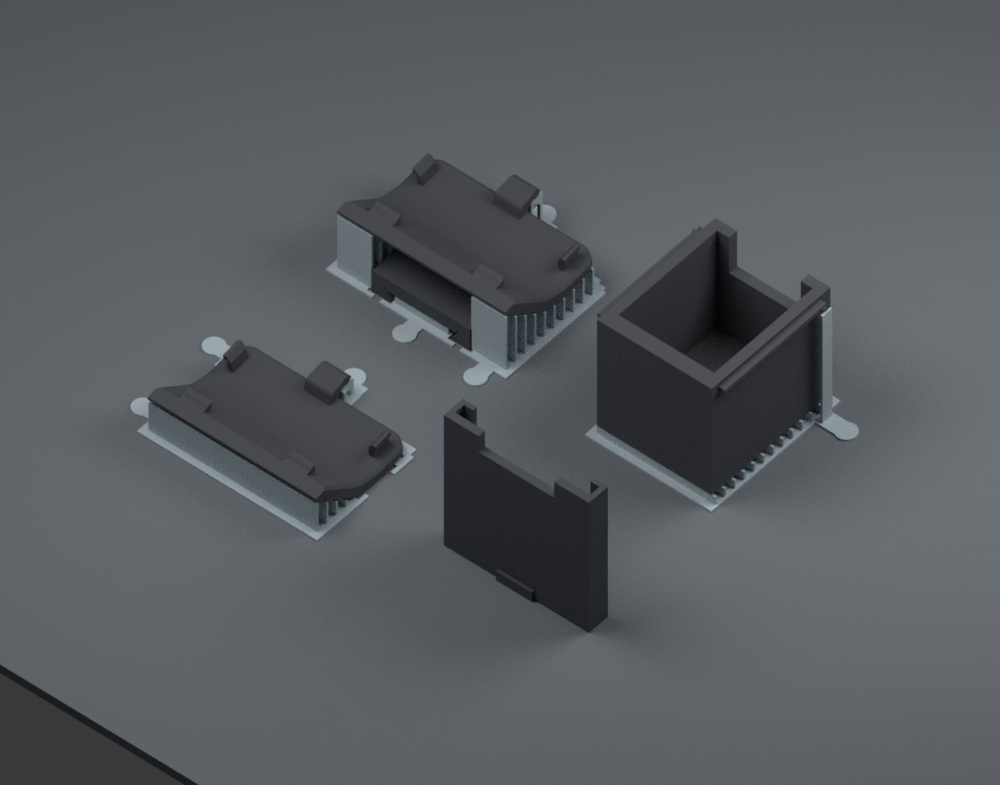

# V24 · Snapmaker U1 · IEMAI matte black PETG · 0.4 mm nozzle

Open **[Vader5Pro_V24_U1_IEMAI_Matte_PETG_Complete.3mf](Vader5Pro_V24_U1_IEMAI_Matte_PETG_Complete.3mf) as a project** in Snapmaker Orca. Keep its saved orientations and support parts. Map its single filament to the U1 tool containing **IEMAI matte PETG, 1.75 mm, black**, then slice and inspect Preview.

The plate includes the revised mount, revised Box 2, matching sliding cap, and an extra controller-cover fit piece. **No locking key is included.** The separate cover is for checking the revised clips before using the full mount; it is not an extra layer installed under the mount. To print only that fit piece first, disable printing for the other three objects temporarily.

Gray identifies sacrificial supports in this illustration. All actual parts and supports print in the same black PETG.

## What changed

| Part | V24 change |
| --- | --- |
| Box 2 interior | Removed the narrower lower step. The existing **20 × 24.5 mm** upper opening now continues down to the floor. Outer size, side rails, USB opening and male mounting rail remain unchanged. Floor remains 2 mm thick. |
| Closing cap | New cap slides on the existing side rails. Continuous clearance channels replace the old small detent pockets. Nominal clearance is 0.30 mm beside the outer hooks and below the side rails; the cap has an end stop and cable notch. |
| Dock key | Removed from the new kit. The old key tunnels in the Vader receiver are filled; its female dovetail and closed stop remain. |
| Front clip feet | Locally 20% thinner in Y, with up to 0.35 mm additional depth. |
| Side hooks | Locally 18% thinner in X, with up to 0.40 mm additional depth. |
| Center tab | Locally 15% thinner in Z, 0.30 mm narrower, extended 0.40 mm in Y and offset 0.40 mm toward the controller. These are blended local changes; compression means the final lowest point does not move by the full offset. |

The cover is **not globally scaled**. The clip changes blend into their roots, and the mesh is simplified within 0.005 mm after deformation. These are modest prototype adjustments based on the reported tight fit; controller measurements and a physical test are still needed to establish final clip fit. See [exact clip-change parameters](../../validation/v24_iemai_petg/clip_changes.json).

The box's original male rail is preserved, so the new box keeps the supplied G7 mount interface. The cavity and cap do not depend on the old internal ledge. The new cap is intended for the original exterior rail profile, including on the supplied older box; actual printer tolerance still matters.

## Cap and mount use

Slide the cap on from the **closed end opposite the USB notch**, pushing it toward the USB end until its rear rail stops seat. The grip ridge is at the closed end. Pull back along the same rails to remove it. There is no small lid detent to force through. Remove the printing brim from the cap's closed end before trying its fit.

For the dock, the box enters through the receiver's open end and slides toward the closed stop. In native CAD coordinates, insertion is toward −Y and removal toward +Y. With the key removed, the box has **no positive axial latch**: retention depends on the printed rail fit and friction, as requested. No pull-out force is established. Check that your PETG print holds securely before carrying a device on it.

## Saved PETG settings

| Setting | Value |
| --- | --- |
| Printer / filament | Snapmaker U1, 0.4 mm nozzle / IEMAI matte PETG, 1.75 mm black |
| Nozzle | 250°C first layer; 245°C afterward |
| Textured PEI bed | 70°C first and subsequent layers |
| Layer / first layer | 0.16 / 0.20 mm |
| Walls / top / bottom | 4 walls / 6 top layers / 5 bottom layers |
| Infill | 25% gyroid |
| Outer / inner walls | 30 / 45 mm/s |
| Top / bridge / first layer | 25 / 20 / 15 mm/s |
| Volumetric flow cap | 6 mm³/s |
| Filament retraction | 0.8 mm at 25 mm/s |
| Main cooling | Off for first 3 layers; 20–35% normally; up to 80% for overhangs |
| Auxiliary fan | Off |
| Supports / raft / purge tower | Automatic generation off / off / off |
| Brim | 3 mm on the standing cap only, with 0.20 mm separation |
| Complete plate estimate | About 2 h 32 min and 19 g, including the cover fit piece and supports |

This is a conservative starting profile, **not a calibrated IEMAI factory profile**. It uses the U1's bundled generic PETG baseline with the above overrides. The specific [IEMAI matte PETG listing](https://ibspot.com/products/iemai-matte-petg-3d-printer-filament-1-75mm-black-1kg) gives 230–270°C nozzle, 60–70°C bed and ≤150 mm/s, and suggests drying at 60°C for 5–8 hours. Follow the actual spool label if it differs. This profile is for ordinary matte PETG, not PETG-CF or PETG-GF.

Dry filament before testing surface quality and stringing. Let the PEI sheet cool before flexing; follow the plate maker's PETG release-layer guidance. Flow and pressure advance may still need calibration for your spool. The project changes do not guarantee a particular surface finish without a print trial.

## Orientations and support removal

- The mount and separate fit cover print with controller clips facing up. The box prints upright with its rail down. Both use thin custom combs and accessible pull tabs, with a nominal 0.32 mm vertical separation and extra 0.25 mm side-clearance cuts for PETG.
- The small angled supports at the cover's center tab reach around the rear edge, leaving the tab's attachment path clear. The box has only a shallow floor frame plus two thin blades under its tiny original rim hooks.
- The cap prints **standing on its closed end**, so its guide channels do not need internal supports. Keep its object-specific brim and saved orientation.

After cooling, peel the comb bases using their tabs. Withdraw the mount's central receiver comb through the channel's open end. Free the angled tab supports gently. On Box 2, flex the two rim-support blades outward before pulling the floor frame down and off the male rail. Hold the broad part surfaces rather than the small clips or hooks. Remove the cap brim and any loose strings before fitting the rails.

Supports are separate modeled parts named **PEEL OFF custom supports**; leave them enabled for printing, then remove them. Do not enable extra automatic support inside the channels. Their PETG removal force has not been physically tested.

## Checks and source

[Geometry/project checks](../../validation/v24_iemai_petg/geometry_and_project_checks.json) · [Layer checks](../../validation/v24_iemai_petg/layer_islands.json) · [Slicing result](../../validation/v24_iemai_petg/slice_result.json) · [OpenSCAD](../../source/v24/Vader5Pro_V24.scad) · [USB-down assembly](../../preview/V24_USB_Down.glb) · [USB-up assembly](../../preview/V24_USB_Up.glb)

Checks cover watertight solids, the uniform cavity, preserved male rail, cap sliding and end stop, both dock orientations, saved 3MF geometry, plate placement and embedded PETG settings. Newly appearing regions larger than 0.03 mm² are checked against the preceding four 0.16 mm layers using a 0.15 mm XY allowance. This checks support placement across the designed gaps; it does not establish physical adhesion or support-removal force.

Orca can still report floating regions or cantilevers because the custom supports deliberately stop short of the part. Those notices are recorded in the slicing result rather than hidden. Review Preview with the custom support volumes visible. The original controller, electronics and cable models were not supplied, so controller attachment and device/cable fit still require a physical check.

To rebuild, install `tools/requirements-u1.txt`, then run `tools/build_v24_geometry.py`, `tools/build_v24_project.py` and `tools/check_v24_layers.py`. Export the seed `source/v24/U1_Oriented_Seed.3mf` using Snapmaker Orca with `source/v24/U1_0p4_machine.json`, `source/v24/U1_PETG_Process.json` and `source/v24/IEMAI_Matte_PETG_Black.json`. Keep `--arrange 0 --orient 0`, then run `tools/validate_v24.py`. The included original-lid reference was read from your [G7 mount repository](https://github.com/Saniro1/Gamesir-G7-Pro-Gyro-Mount); the V24 cap itself is defined procedurally in the new SCAD source.
