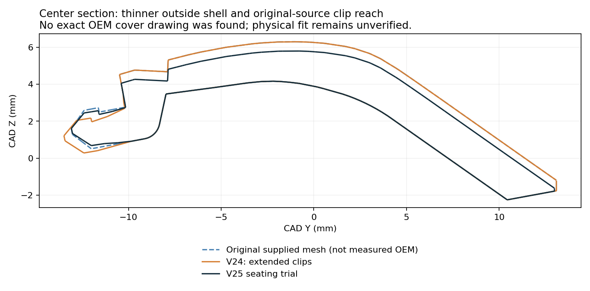

# V25 · controller-cover seating trial and PETG print-quality project

**[Download the native Snapmaker Orca 3MF](Vader5Pro_V25_PETG_Seating_Trial_Quality.3mf).** Open it as a project and map the single filament to your black **IEMAI matte PETG 1.75 mm** tool on the U1 with a 0.4 mm nozzle.

## What the photos and measurements establish

The owner reports that **V24 PETG does not seat fully**. Their approximate corner-to-corner readings are 0.91 inch for the print and 0.90 inch for the OEM cap, a reported difference of 0.254 mm. The measurement axis and datums are not established, so those numbers are not treated as complete CAD dimensions.

No verified, dimensioned OEM cover drawing was found. Public references describe the V2 phone-mount interface and controller dimensions, but neither establishes this cover's exact outline, wall thickness or latch locations. The OEM photos show its shape and a thinner-looking shell, not a millimeter scale. **V25 is a seating trial, not a certified OEM replica.**

V24 had extended the clip feet/hooks by 0.35–0.40 mm and the center tab outward by 0.40 mm. Because the printed cover now fails to seat, V25 restores the **original supplied mesh's clip reach** while retaining localized thinning. The original supplied mesh itself has not been independently certified against the OEM cap.

## Geometry changes

- Restored original-source clip reach; removed V24's added depth and center-tab extension. Latch centers are not globally rescaled.
- Added **0.10 mm clearance at each X rim edge** and **0.10 mm relief at the positive-Y border**.
- Relieved the broad shell's exterior by up to **0.50 mm vertically**, with protected clip/root regions. The sampled controller-facing lower sheet remains within 0.005 mm of the original supplied surface.
- Lowered the external joining pad to maintain a connected receiver-to-cover joint. Sampling verifies that the pad does not intrude below the lower sheet at the tested central points; this is not a strength test.
- Retained the V24 uniform-cavity box, sliding lid, male rail and keyless receiver interface. Existing V24 Box 2 and sliding-cap prints can still be used.

The resulting trial-cover envelope is approximately **35.00 × 26.06 × 8.48 mm**. This is the measured candidate mesh envelope, **not a claimed OEM dimension**. V24's envelope was approximately 35.20 × 26.56 × 9.33 mm; overall-envelope reductions also include restored clip reach.

This compares the supplied source mesh, V24 and V25 at the center section. It does not trace or dimension the photographed OEM part.

## Five separate plates in one file

| Plate | Contents | Estimated print time | Estimated PETG |
| --- | --- | ---: | ---: |
| **1 — fit check first** | Bare controller cover with its removable supports | 26 min | 2.5 g |
| 2 | Full mount using the same trial cover | 57 min | 5.1 g |
| 3 | Box 2 and its supports | 1 h 27 min | 8.4 g |
| 4 | Sliding lid, standing on its closed end with a brim | 36 min | 2.1 g |
| 5 — optional | Two-post travel/stringing check | 23 min | 1.1 g |

Print only the selected plate and clear the bed before another plate. Each plate holds one object assembly, so layers no longer jump repeatedly between distant kit parts. This reduces cross-part stringing opportunities without using collision-sensitive sequential printing on a packed plate.

If the trial cover still does not seat flush, stop after plate 1 and identify which edge or latch contacts first. Do not force it or print the full mount expecting a different fit: plate 2 uses the same controller interface. The outward slide receiver itself remains external; the fit correction targets the cover's seating interface and rim.

## Revised PETG quality settings

| Setting | V25 |
| --- | --- |
| Layer / first layer | **0.12 / 0.20 mm** |
| Nozzle | **245°C first layer, 240°C afterward** |
| Textured PEI bed | 70°C |
| Outer / inner / top speed | 25 / 40 / 20 mm/s |
| Volumetric flow limit | 5 mm³/s |
| Retraction | **1.0 mm at 35 mm/s**, 25 mm/s recovery |
| Wipe | Enabled, 2 mm; 70% of retraction before wiping |
| Minimum travel for retraction | 0.8 mm |
| Z-hop | **0.20 mm**, reduced from 0.40 mm |
| Travel | 250 mm/s; avoid crossing walls where possible |
| Cooling | 25–40% normally, off for the first 3 layers; stronger overhang cooling retained |
| Timelapse | Capture/start/stop commands removed from this project's printer G-code |
| Structure | 4 walls; 25% gyroid; 8 top and 7 bottom layers |

Homing, bed leveling, nozzle cleaning and the U1's other stock startup operations are retained. The project changes do not alter printer firmware. Timelapse capture commands are omitted to avoid any capture-related parking or dwell; they are not claimed to be the sole cause of the earlier stringing.

These are starting settings for dry IEMAI matte PETG, not a physically calibrated factory profile. **Dry the filament before judging stringing.** The matte-product listing suggests 60°C for 5–8 hours; follow the actual spool label if different. Moisture can cause both fine webs and rough extrusion even with good retraction settings. Inspect the nozzle for stuck PETG and use flow/temperature calibration if strings persist. Plate 5 provides a small repeatable test under the saved settings.

References: [Snapmaker U1 stringing/oozing guide](https://wiki.snapmaker.com/en/snapmaker_u1/troubleshooting/stringing_or_oozing), [IEMAI matte PETG product guidance](https://ibspot.com/products/iemai-matte-petg-3d-printer-filament-1-75mm-black-1kg), [V2 interface compatibility information](https://flydigi.info/accessories/). None provides verified OEM cover dimensions.

## Supports and checks

Custom PETG combs remain enabled as modeled volumes, with a nominal 0.32 mm vertical gap and extra side-clearance cuts. Automatic supports stay off. After the plate cools, peel the bases using their tabs, withdraw the receiver's central comb through its open end, and free the small angled tab supports gently. The lid needs only its brim removed. Avoid levering against the snap features.

Orca may still flag floating regions/cantilevers at the deliberately separated custom supports. Those warnings are recorded. Independent checks verify the support placement at the new 0.12 mm layer spacing using material in the preceding five layers and a 0.15 mm XY allowance. Neither support-removal force nor controller fit has been physically verified.

All five plates were reopened and sliced in Snapmaker Orca 2.4.1. Saved project geometry, U1 settings, plate bounds, cap/dock movement, rail preservation, retraction/wipe commands and absence of timelapse-capture commands were checked. See [fit-trial assumptions](../../validation/v25_quality/fit_trial.json), [geometry/project checks](../../validation/v25_quality/geometry_and_project_checks.json), [layer checks](../../validation/v25_quality/layer_islands.json) and [slicing results](../../validation/v25_quality/slice_result.json).

Rebuild with the dependencies in `tools/requirements-u1.txt`, then run `tools/build_v25_geometry.py`, `tools/build_v25_project.py`, and `tools/check_v25_layers.py`. Export `source/v25/U1_Oriented_Seed.3mf` with the three V25 machine/process/filament JSON files using Snapmaker Orca, retaining `--arrange 0 --orient 0 --allow-newer-file`. Run `tools/validate_v25.py` on the exported project.
