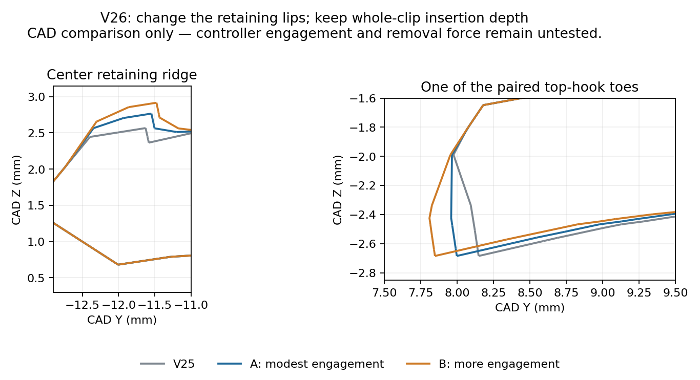

# V26 controller retention trials — U1 / IEMAI matte PETG

Start with [the two-cover fit-test project](Vader5Pro_V26_Cover_Fit_Trials_Only.3mf). Print **plate 1, cover A**, remove its custom supports, and check seating and retention on the controller. Estimated print: 23m 50s, 2.24 g. If A seats fully but still slides off too easily, try **plate 2, cover B** (23m 49s, 2.25 g). Do not force B if A cannot seat fully.

The [complete seven-plate project](Vader5Pro_V26_Retention_Trials_Complete.3mf) contains both covers, both matching full mounts, Box 2, its sliding lid, and an optional stringing test. Print only the matching mount after selecting a cover; you do not need both mounts.

| Plate | Part |
| --- | --- |
| 1 | Cover A: modest retention increase |
| 2 | Cover B: larger retention increase |
| 3 | Full mount matching A |
| 4 | Full mount matching B |
| 5 | Shared Box 2, unchanged from V25 |
| 6 | Sliding box lid, unchanged from V25 |
| 7 | Optional stringing test |

## Changes from V25

The owner reports better seating with V25, but the cover can be pulled back and falls off. Insufficient hook/catch engagement is a plausible explanation, not a confirmed measurement of the controller. Comparing CAD showed that earlier thinning also reduced the central retaining crest by approximately 0.16 mm and shortened the paired hook toes slightly.

| Local change relative to V25 | A | B |
| --- | --- | --- |
| Central retaining ridge height added | 0.20 mm | 0.35 mm |
| Central stop face moved forward | 0.08 mm | 0.15 mm |
| Paired top-hook toe reach added | 0.15 mm | 0.30 mm |
| Additional whole-clip insertion depth | 0 | 0 |
| Additional broad exterior shell relief | 0.25 mm | 0.25 mm |

The exterior relief totals 0.75 mm relative to the original source in the relieved shell region. Hook roots are protected and the previously thinned stems remain. This is a local geometry revision, without global scaling. There is no verified OEM drawing or exact OEM wall-thickness measurement available. Both variants require physical testing.

## Printing and support removal

Open the 3MF **as a project** in Snapmaker Orca, using the U1 standard 0.4 mm nozzle. Keep 100% scale, the saved orientations and custom support objects. Automatic supports are off because separate peelable support geometry is included. Map the filament to your black IEMAI matte PETG tool.

Settings are unchanged from the V25 quality project: 0.12 mm layers, 0.20 mm first layer, 245°C first layer / 240°C subsequent layers, 70°C textured PEI bed, 1 mm retraction at 35 mm/s, 2 mm wipe with 70% retraction before wiping, 0.20 mm Z hop, and 5 mm³/s maximum volumetric speed. These are starting settings, not a physical filament calibration. Use dry filament if stringing persists. Timelapse capture commands are removed from this project; normal printer startup routines are retained.

After cooling, peel the custom supports using their pull tabs. Work gently around the small hooks and remove any support remnants or strings beneath their retaining faces. Check the bare cover first, then the matching full mount without a loaded box. Confirm it seats fully and resists a gentle backward pull. Stop if it requires excessive force or starts whitening/cracking. Support removal and retention force remain physically untested.

## Validation and source

Both native 3MF projects were exported and sliced with Snapmaker Orca 2.4.1. Mesh, support separation, plate placement, saved PETG settings and complete-project extrusion bounds passed checks. Matching cover and mount controller interfaces agree in CAD. The existing box/lid sliding clearance and dock compatibility checks also pass.

Orca reports floating-region/cantilever warnings on the custom-supported cover/mount/box plates because the supports have deliberate breakaway gaps. Independent layer-overlap checks pass; inspect the sliced preview before printing. A successful slice does not verify controller fit or support removal.

[Geometry/project checks](../../validation/v26_retention/geometry_and_project_checks.json) · [Slice estimates and checks](../../validation/v26_retention/slice_result.json) · [Fit-only slice](../../validation/v26_retention/fit_only_slice_result.json) · [Retention parameters](../../validation/v26_retention/retention_trials.json) · [OpenSCAD source](../../source/v26/Vader5Pro_V26.scad)
