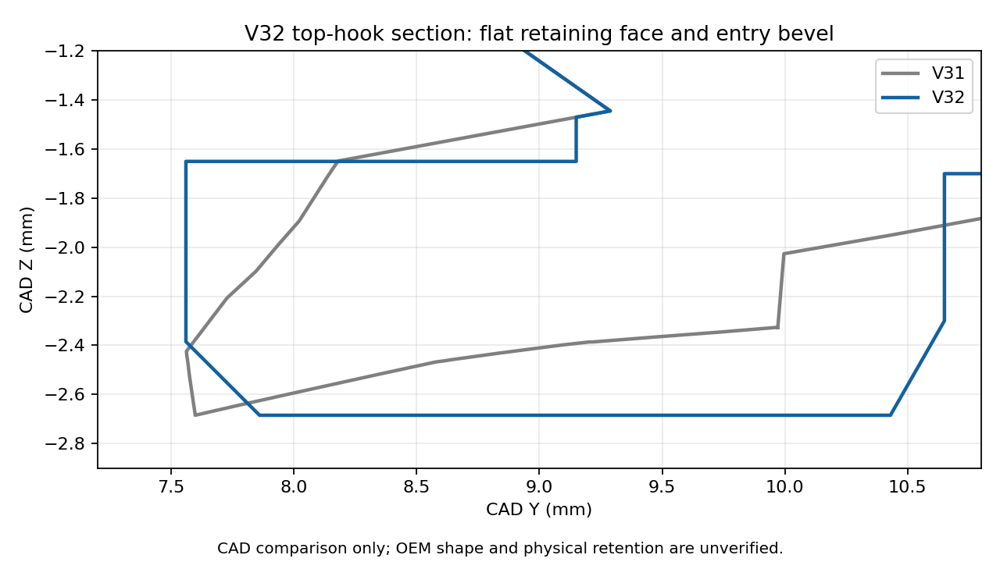

# V32 — rebuilt top-hook edges / Snapmaker black PLA

[Small cover test](Vader5Pro_V32_PLA_Reshaped_Hooks_Test.3mf) · [All functional parts on ONE plate](Vader5Pro_V32_All_Parts_One_Plate_PLA.3mf) · [Separate-plate project](Vader5Pro_V32_PLA_Reshaped_Hooks_Complete.3mf)

The owner reports V31 still fails to hook and the edges differ from the OEM. CAD inspection confirms that the repeated extensions retained a tapered/sloping hook profile. V32 rebuilds both fixed top-hook ends with a **flat retaining ledge, a defined leading shoulder, a 0.30 mm entry bevel and 0.15 mm plan-view corner chamfers**. The intended tip reach and lowest Z remain approximately V31's values. The improved V29 middle tongue and shell/underside relief remain. This is a new, unverified hook-profile trial; the photo comparison cannot establish an exact OEM profile.

Each rebuilt hook is 5 mm wide. The new horizontal retaining face is at CAD Z=-1.65 mm, leading Y=7.56 mm and lowest Z=-2.685 mm. Old material in the leading ramp is removed before the new toe is united with the preserved stem. No extra whole-clip insertion depth is intentionally added. Regions outside the edited hooks match V31 within 0.01 mm sampled surface error after mesh simplification. Box, lid and receiver are unchanged.

## Print and check

Start with the small cover test, remove all brim/support material after cooling, and test gently. Stop if it cannot seat or needs excessive force. A square ledge may increase insertion/removal force; physical strength, retention and fit remain unverified. Keep the prior cover for comparison.

The one-plate project prints the **full mount, Box 2 and sliding lid together**, layer by layer, with existing custom supports and separate 5 mm brims. Use this for one assembly in one job after confirming cover fit. The separate-plate version has cover, mount, box, lid and optional stringing test on plates 1–5.

Open the 3MF **as a project** in Snapmaker Orca, retaining the saved **U1 standard 0.4 mm nozzle / Textured PEI Plate / regular Snapmaker PLA black** setup and orientations. Map the filament to the tool holding that PLA. Keep 100% scale and all custom support objects.

Settings remain: 220°C nozzle, 65°C bed, 0.12 mm layers / 0.20 mm first layer, four walls, 25% gyroid, 8 mm³/s flow cap, 0.8 mm retraction at 30 mm/s, 2 mm wipe, 0.20 mm Z hop, PLA cooling and at least 0.20 mm designed support top separation. [Full inherited settings](../v28_pla/README.md). These remain uncalibrated starting settings.

## Validation

[Hook profile geometry](../../validation/v32_pla/hook_profile_change.json) · [Native geometry/settings](../../validation/v32_pla/geometry_and_project_checks.json) · [Layer checks](../../validation/v32_pla/layer_islands.json) · [One-plate placement](../../validation/v32_pla/one_plate_checks.json) · [Separate-plate slicing](../../validation/v32_pla/slice_result.json) · [One-plate slicing](../../validation/v32_pla/one_plate_slice_result.json) · [Geometry builder](../../tools/build_v32_geometry.py)

Native Snapmaker Orca 2.4.1 projects are independently sliced. Support gaps can trigger floating-region/cantilever warnings; inspect the preview. CAD/slicing checks do not prove physical fit, reliable printing or latch durability. No dimensioned OEM interface is available. Use the Python builder's Manifold union for reproducible full mount geometry; legacy CGAL import unions can fail on mesh tolerance. Source print profiles retain earlier setting names because their parameters are unchanged.
