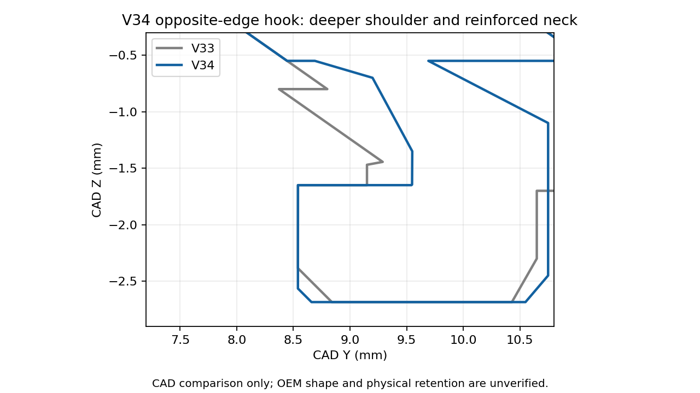

# V34 — reinforced opposite-edge hooks, printed on their sides

[Small cover test](Vader5Pro_V34_PLA_Reinforced_Hooks_Test.3mf) · [All functional parts on ONE plate](Vader5Pro_V34_All_Parts_One_Plate_PLA.3mf) · [Separate-plate project](Vader5Pro_V34_PLA_Reinforced_Hooks_Complete.3mf)

The owner confirms the failing pair is **opposite the middle clip**. V33's shell fits better, but the printed hooks are rounded, slip off, and one broke. V34 retains the measured shell/middle clip and revises this pair's ledge, neck, reinforcement and printing orientation. It is a physical trial, not an exact measured OEM hook copy.

| Change | V34 |
| --- | --- |
| Retaining shoulder | About 1.01 mm flat projection, compared with roughly 0.61 mm in the prior central section |
| Neck | 1.20 mm nominal Y thickness |
| Root reinforcement | Two 0.60 mm-wide side gussets at each hook |
| Entry chamfer | Reduced from 0.30 to 0.12 mm; more of the lip remains |
| Tip reach / lowest insertion Z | Retained: nominal 4 mm inward datum / Z=-2.685 mm |
| Cover/mount printing orientation | **90° about Y, on the side**, so the hook profile lies within each XY layer |
| Cover/mount designed custom support gap | At least 0.16 mm; layer quantization can increase actual separation |

The measured **35 × 21 mm shell, 5 × 5 mm middle tongue and 26 mm overall** remain. Other attachment regions match the prior geometry within 0.01 mm sampled surface error. The 4 mm inward top-clip datum is inherited from the prior assumption; exact OEM profile, clearances and force remain unknown. Added root material may change local clearance and must be checked on the controller. Neck/gussets are intended to reduce breakage, but no strength or fatigue test has been performed.

The central section shows the shoulder and neck; the side gussets sit near the hook's X edges and are not visible in that section.

## Print the small test first

**Keep the saved side orientation. Do not auto-orient the cover or mount back to the old flat pose.** The old pose puts the small lips above the shell as overhangs. Side printing places the L profile in the layer plane, which is intended to improve contour definition and load direction. It increases the bare-cover estimate to **43m 26s**. This is a slicer estimate, not a measured print time.

Open the 3MF **as a project** in Snapmaker Orca. Retain U1 standard 0.4 mm nozzle / Textured PEI Plate / regular Snapmaker black PLA and map to the tool holding that PLA. Keep 100% scale, custom supports and 5 mm contacting brims. Settings remain 220°C nozzle, 65°C bed, 0.12 mm layers / 0.20 mm first, four walls, 25% gyroid, 8 mm³/s flow cap, 0.8 mm retraction at 30 mm/s, 2 mm wipe, 0.20 mm Z hop and PLA cooling. [Full inherited material settings](../v28_pla/README.md).

Let the part cool before removing supports. Start at the support bases/pull tabs; do not pry against or pull on the hooks. Inspect the undercuts and remove all residual support before fitting. Seat gently and check clearance and retention without a loaded box. Stop if insertion needs excessive force, a root whitens, or it begins to crack. The sharper shoulder can increase insertion/removal force.

After the test cover fits, the **one-plate project** prints the matching full mount, Box 2 and sliding lid together, estimated **2h 53m 47s**. The mount also has the new side orientation. Existing good box/lid prints can be reused. The separate-plate project has cover, mount, box, lid and optional stringing test on plates 1–5.

## Verification

[Reinforcement geometry](../../validation/v34_pla/hook_reinforcement.json) · [Native geometry/settings](../../validation/v34_pla/geometry_and_project_checks.json) · [Layer/support checks](../../validation/v34_pla/layer_islands.json) · [Actual straight shoulder extrusion paths](../../validation/v34_pla/hook_toolpath_checks.json) · [One-plate placement](../../validation/v34_pla/one_plate_checks.json) · [Separate-plate slicing](../../validation/v34_pla/slice_result.json) · [One-plate slicing](../../validation/v34_pla/one_plate_slice_result.json)

Orca 2.4.1 exports are independently sliced. Straight shoulder outer-wall segments are confirmed in both hook layer bands; this checks planned paths, not physical edge sharpness. Deliberate custom support gaps may trigger floating-region/cantilever warnings; inspect the preview. No CAD/slicing test establishes reliable printing, strength, holding force or OEM fit. Use the Python geometry builder and its Manifold union for reproducible mesh assembly; legacy CGAL import unions can fail on mesh tolerances. No user photos or scan imagery are published.
