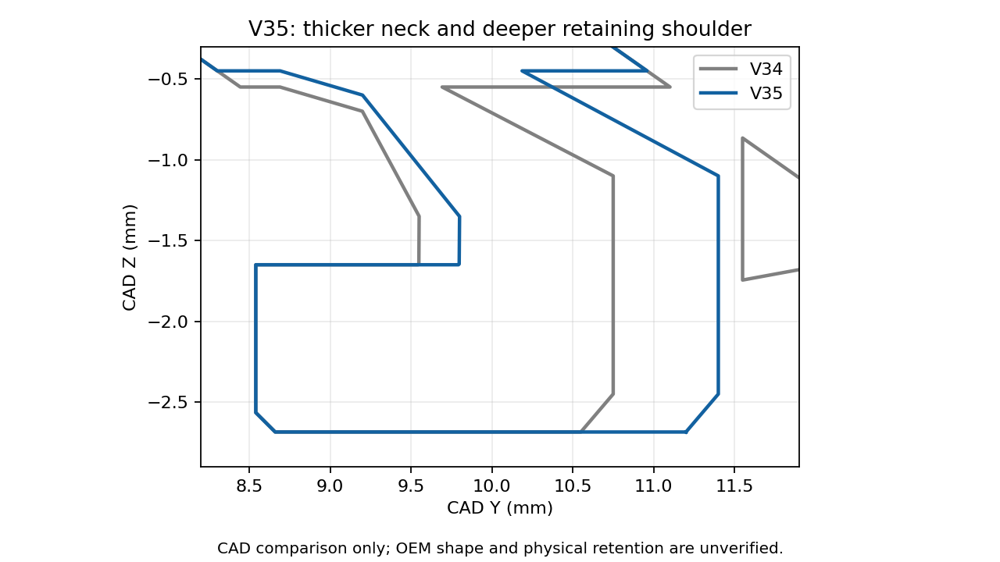

# V35 — wider, stiffer controller-engaging hooks

[Small cover test](Vader5Pro_V35_PLA_Wider_Hooks_Test.3mf) · [All functional parts on ONE plate](Vader5Pro_V35_All_Parts_One_Plate_PLA.3mf) · [Separate-plate project](Vader5Pro_V35_PLA_Wider_Hooks_Complete.3mf)

The owner reports the sliding hooks bend and slide off and supplies close-ups of the controller's retaining ledges. V35 widens and stiffens the **pair opposite the middle tongue**, retaining the measured shell and middle clip. The photos suggest available space but do not establish a measured slot width. The 6 mm width is a modest trial, not verified controller clearance.

| Feature | V34 | V35 |
| --- | --- | --- |
| Each hook width across CAD X | 5 mm | **6 mm**, centered at the same location |
| Neck thickness along CAD Y | 1.2 mm | **1.6 mm** |
| Flat retaining shoulder projection | ~1.01 mm | **~1.26 mm** |
| Side gusset width, two per hook | 0.6 mm | **0.8 mm** |
| Tip reach from shell edge | 4 mm | 4 mm, unchanged |
| Lowest insertion Z | -2.685 mm | -2.685 mm, unchanged |
| Entry chamfer | 0.12 mm | 0.12 mm |

Wider hook bodies and thicker necks are intended to reduce bending; actual stiffness, holding force, durability and slot clearance remain untested. Root material is added behind the retaining shoulder, with larger triangular braces. This can change local clearance even though maximum tip reach/insertion depth remain the same. If the wider hooks catch the opening or require force, stop rather than forcing the controller plastic.

The **35 × 21 mm shell, 5 × 5 mm middle tongue and 26 mm overall** remain. Sampled surface error outside the modified hooks/root region is below 0.01 mm after mesh simplification. Other clip locations, box, lid and receiver remain as before. The 4 mm inward clip datum is inherited from the previous assumption; no exact OEM hook profile is claimed.

The section shows the deeper shoulder/thicker neck. It does not show the width increase or the two edge gussets.

## Printing and checking

Start with the **small cover test**, estimated **43m 33s**. **Keep the saved side orientation** for both cover and full mount; the hook profile lies in each layer's XY plane. Do not auto-orient them back to the old flat pose. Keep all custom supports and brims. After cooling, remove supports from their bases without levering against a hook, then clear remnants before fitting. Check unforced insertion, seating and retention before adding a loaded box. More holding force is an intended outcome, not a verified result.

Open as a project in Snapmaker Orca and retain **U1 standard 0.4 mm nozzle / textured PEI / regular Snapmaker black PLA**. Map to the tool containing that PLA; keep 100% scale. Parameters remain 220°C nozzle, 65°C bed, 0.12 mm layers / 0.20 mm first, four walls, 25% gyroid, 8 mm³/s flow cap, 0.8 mm retraction at 30 mm/s, 2 mm wipe, 0.20 mm Z hop, PLA cooling and 5 mm contacting brims. Custom support design gap is at least 0.16 mm for cover/mount and 0.20 mm for the box; layer quantization may increase actual separation. [Full inherited material settings](../v28_pla/README.md).

The **one-plate project** prints the full mount, shared Box 2 and sliding lid together, estimated **2h 53m 39s**. Existing good box/lid prints can be reused. The separate-plate project has cover, mount, box, lid and optional stringing test on plates 1–5.

## Verification

[Widening/reinforcement geometry](../../validation/v35_pla/wider_hook_checks.json) · [Native meshes/settings](../../validation/v35_pla/geometry_and_project_checks.json) · [Layer/support checks](../../validation/v35_pla/layer_islands.json) · [Straight retaining-shoulder toolpaths](../../validation/v35_pla/hook_toolpath_checks.json) · [One-plate layout](../../validation/v35_pla/one_plate_checks.json) · [Separate-plate slicing](../../validation/v35_pla/slice_result.json) · [One-plate slicing](../../validation/v35_pla/one_plate_slice_result.json)

Snapmaker Orca 2.4.1 exports are independently sliced. Straight shoulder outer-wall segments are confirmed for both hook layer bands, which verifies planned paths rather than physical sharpness. Deliberate support gaps can trigger floating-region/cantilever warnings; inspect the preview. CAD/slicing checks cannot establish controller clearance or physical strength. Use the Python geometry builder's Manifold union for reproducible assembly; legacy CGAL import unions can fail on mesh tolerances. No private user photos or scan imagery are published.
