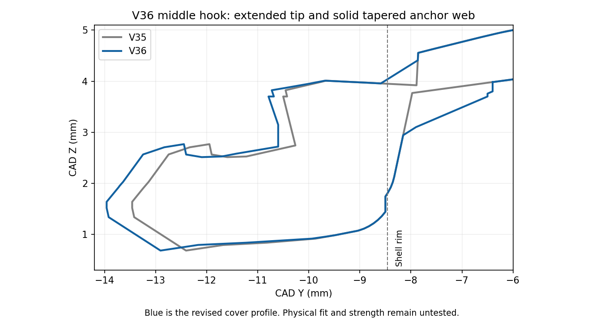

# V36 — longer hooks with solid middle-hook anchor

[Small cover test](Vader5Pro_V36_PLA_Longer_Anchored_Hooks_Test.3mf) · [All functional parts on ONE plate](Vader5Pro_V36_All_Parts_One_Plate_PLA.3mf) · [Separate-plate project](Vader5Pro_V36_PLA_Longer_Anchored_Hooks_Complete.3mf)

The owner requests longer opposite-edge top hooks and a longer, firmly attached bottom middle hook, which appears floating and falls off. V35 was one connected CAD component but had a narrow, abrupt middle-root connection. V36 extends the hooks and fills that connection with a tapered, full-width solid web and a spread root inside the shell. Physical strength and fit remain unverified.

| Feature | V35 | V36 |
| --- | --- | --- |
| Top hook reach inward from rim | 4.0 mm | **4.3 mm** (+0.30) |
| Top hook width / neck | 6 / 1.6 mm | Retained |
| Middle tongue projection beyond shell rim | 5.0 mm | **5.5 mm** (+0.50) |
| Projecting middle tongue width | 5 mm | Retained |
| Middle-root anchor | Narrow stepped connection | **5 mm full-width tapered web**, spreading to 7 mm within shell |
| Sampled root Z thickness | Thin/narrow stepped transition | Approximately **1.3–1.5 mm** at reported sample locations |
| Shell | 35 × 21 mm | Retained |
| Overall including middle tongue | 26 mm | **26.5 mm** because the tongue is intentionally longer |

The middle extension moves its existing catch with the tip while leaving the shell-side origin in place. The web joins the shell and tongue with positive-volume overlap, rather than point/edge contact. Each completed cover and mount is a single closed connected mesh. The root expands to 7 mm only inside the shell boundary; the projecting tongue remains 5 mm. Unmeasured local clearance around this added material remains unknown. The old 26 mm overall OEM measurement is deliberately exceeded by the newly requested 0.50 mm extension.

**The new solid root web is part of the cover—leave it attached.** Remove only the separate custom support mesh and brim. Do not lever against the tongue or top hooks when removing supports.

## Print the cover first

The small cover project is estimated at **43m 38s**. **Keep the saved side orientation**: the hook profiles and root web lie within the layer plane. Do not auto-orient back to the old flat pose. Open as a project in Snapmaker Orca, retain U1 standard 0.4 mm nozzle / textured PEI / regular Snapmaker black PLA and map it to the tool containing that filament. Keep 100% scale and all custom supports/brims.

Printing parameters remain 220°C nozzle, 65°C bed, 0.12 mm layers / 0.20 mm first, four walls, 25% gyroid, 8 mm³/s flow cap, 0.8 mm retraction at 30 mm/s, 2 mm wipe, 0.20 mm Z hop, PLA cooling and 5 mm contacting brims. Custom support design gaps remain at least 0.16 mm for cover/mount and 0.20 mm for the box, subject to layer quantization. [Full inherited settings](../v28_pla/README.md).

Let it cool, remove supports carefully, and clear all remnants from the clips. Check unforced seating, clearance and retention with the bare cover before printing the full mount. Longer hooks and added root material may bottom out or interfere even though stiffness is intended to improve. Stop if force, whitening or cracking occurs. No force/strength/durability test has been performed.

The **one-plate project** prints the matching full mount, shared Box 2 and sliding lid together, estimated **2h 54m 46s**. Reuse an already good box/lid. The separate-plate project has cover, mount, box, lid and optional stringing test on plates 1–5.

## Checks and source

[Root and reach geometry](../../validation/v36_pla/anchored_hook_checks.json) · [Native meshes/settings](../../validation/v36_pla/geometry_and_project_checks.json) · [Layer/support checks](../../validation/v36_pla/layer_islands.json) · [Middle-root extrusion coverage](../../validation/v36_pla/middle_root_toolpaths.json) · [Top-shoulder paths](../../validation/v36_pla/hook_toolpath_checks.json) · [One-plate layout](../../validation/v36_pla/one_plate_checks.json) · [Separate-plate slice](../../validation/v36_pla/slice_result.json) · [One-plate slice](../../validation/v36_pla/one_plate_slice_result.json) · [Geometry builder](../../tools/build_v36_geometry.py)

Snapmaker Orca 2.4.1 exports are independently sliced. Several central hook layers are checked for extrusion across an interior line through the thicker root, and straight shoulder contours are checked for both top hooks. These verify planned material paths, not physical bond strength. Deliberate support gaps may trigger floating-region/cantilever warnings; inspect the preview. Controller contact geometry, exact OEM hook profiles and real printed fit remain unverified. Use the Python builder's Manifold union for reproducible mesh assembly; legacy CGAL import unions can fail on tolerances. No user photos or scan images are published.
