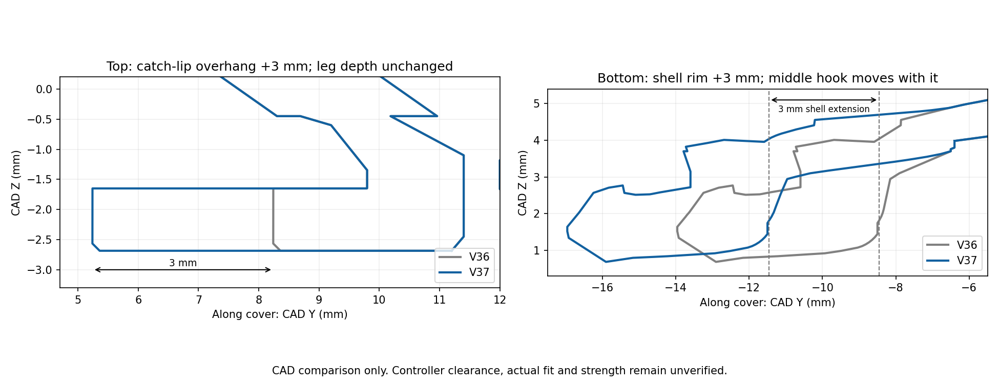

# V37 — catch lips +3 mm; main lower shell edge +3 mm

[Small cover test](Vader5Pro_V37_PLA_Extended_Shell_Catch_Lips_Test.3mf) · [All functional parts on ONE plate](Vader5Pro_V37_All_Parts_One_Plate_PLA.3mf) · [Separate-plate project](Vader5Pro_V37_PLA_Extended_Shell_Catch_Lips_Complete.3mf)

The owner clarified both corrections: extend **only the top catch-lip overhang by 3 mm**, not the hook legs deeper into the controller; extend the **main curved lower cover edge by 3 mm**, not just the middle tongue. V37 applies these changes relative to V36.

| Feature | V36 | V37 |
| --- | --- | --- |
| Top catch-lip inward reach from upper rim | 4.3 mm | **7.3 mm** (+3) |
| Top hook leg insertion depth / lowest Z | Z=-2.685 mm | **Unchanged** |
| Top hook width / neck | 6 / 1.6 mm | Retained |
| Main shell width × up/down extent | 35 × 21 mm | **35 × 24 mm** |
| Middle tongue projection beyond its local rim | 5.5 mm | Retained; moves with lower rim |
| Overall including middle tongue | 26.5 mm | **29.5 mm** |
| Middle root | Full-width solid tapered anchor | Retained and blended into extended shell |

The lower shell grows via a continuous localized stretch of the last 2 mm of the old lower panel, adding 3 mm at its rim. X/Z coordinates are retained in this lower region; this extends the profile without globally scaling the cover. The protruding middle tongue moves with the new rim and stays 5 mm wide / 5.5 mm projecting. The root web remains a solid part of the cover; sampled sections stay over 1.15 mm thick. Low controller-contact faces of the supplementary side latches are excluded from the stretch, while their root transition blends into the new shell. Their sampled contact-surface error is checked below 0.01 mm.

The top pair is rebuilt with the longer lip and unchanged neck, gussets, tip Z-depth and small 0.12 mm entry chamfer. This is substantially more overhang; free-end flex and contact interference can increase despite the unchanged reinforced neck. No new controller-clearance measurement was supplied. The 24 mm shell deliberately supersedes the earlier 21 mm target based on the owner's 3 mm fit shortfall; it is a fit correction, not a new independently measured OEM specification.

## Print the test first

The small cover is estimated at **44m 49s**. **Keep the saved side-print orientation**, custom supports, 5 mm contacting brims and 100% scale. Open as a project in Snapmaker Orca and retain **U1 standard 0.4 mm nozzle / textured PEI / regular Snapmaker black PLA**. Map it to the tool holding that filament.

Settings remain 220°C nozzle, 65°C bed, 0.12 mm layers / 0.20 mm first, four walls, 25% gyroid, 8 mm³/s flow cap, 0.8 mm retraction at 30 mm/s, 2 mm wipe, 0.20 mm Z hop and PLA cooling. Supports are regenerated for the new shape with at least 0.16 mm designed gap on cover/mount and 0.20 mm on the box, subject to layer quantization. [Full inherited material settings](../v28_pla/README.md).

After cooling, remove separate supports and brim without prying on the clips. **Leave the solid middle-root web attached.** Inspect clean clips, then test seating and retention gently. Stop if the longer lips or shell bottom out or require excessive force. Physical strength, clearances, fit and retention remain unverified.

After the cover passes, the **one-plate project** prints the matching full mount, shared Box 2 and sliding lid together, estimated **2h 57m 8s**. Reuse already good box/lid prints. The separate-plate project contains cover, mount, box, lid and optional stringing test on plates 1–5.

## Checks and source

[Direction and dimension checks](../../validation/v37_pla/direction_correction.json) · [Native meshes/settings](../../validation/v37_pla/geometry_and_project_checks.json) · [Layer/support checks](../../validation/v37_pla/layer_islands.json) · [Middle-root extrusion coverage](../../validation/v37_pla/middle_root_toolpaths.json) · [Top-shoulder toolpaths](../../validation/v37_pla/hook_toolpath_checks.json) · [One-plate layout](../../validation/v37_pla/one_plate_checks.json) · [Separate-plate slice](../../validation/v37_pla/slice_result.json) · [One-plate slice](../../validation/v37_pla/one_plate_slice_result.json) · [Geometry builder](../../tools/build_v37_geometry.py)

Snapmaker Orca 2.4.1 projects are independently sliced. Root coverage and straight catch-shoulder paths are verified in sampled layers; this checks planned extrusion, not physical bond strength or sharpness. Native meshes are closed, with cover and mount each one connected solid. Support gaps may trigger floating-region/cantilever warnings; inspect the preview. Use the Python builder's Manifold union for reproducible geometry; legacy CGAL import unions may fail on mesh tolerances. No user photos or scan imagery are published.
