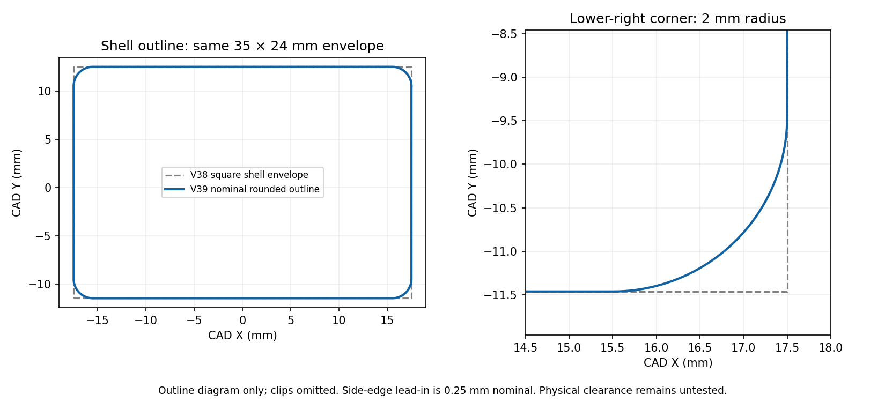

# V39 — rounded outer shell corners and side-edge lead-in

[Small cover test](Vader5Pro_V39_PLA_Rounded_Edges_Test.3mf) · [All functional parts on ONE plate](Vader5Pro_V39_All_Parts_One_Plate_PLA.3mf) · [Separate-plate project](Vader5Pro_V39_PLA_Rounded_Edges_Complete.3mf)

The owner reports the squared cover edges prevent it from sliding fully down into the rounded controller recess. V39 targets only that shell-edge clearance. V38's top lips, middle catch, reinforced roots, widths and leg depth are retained within export tolerance.

| Feature | V39 |
| --- | --- |
| Four outer shell plan-view corners | **2 mm nominal radius** |
| Two side-edge lead-ins | **0.25 mm nominal tapered relief** on the controller-facing side, following the existing shell curvature |
| Central shell envelope | **35 × 24 mm**, retained |
| Top catch-lip reach | **6.3 mm**, retained |
| Middle tongue projection | **4.5 mm**, retained |
| Overall with middle tongue | Approximately **28.5 mm**, retained |

The corner mask rounds the shell outline without globally rescaling it. The side lead-in is limited to the perimeter at |CAD X|≥14.2 mm, clear of the paired retaining hooks and middle anchor. Straight center portions of the upper/lower edges remain. A separate mask preserves the projecting middle tongue. All clip/root surfaces in the checked regions agree with V38 within 0.01 mm sampled distance; the observed maximum is recorded in the report.

The lead-in cutter overlaps the outline by 0.01 mm to avoid coincident-wall remnants. Exported cover and complete mount are independently compared, so the bare cover and mounted assembly have consistent controller-facing surfaces. Two-millimeter corner radius is a fitting trial, not a measured OEM radius. Physical seating remains untested.

## Print the small cover first

The test cover is estimated at **44m 34s**. Open the 3MF **as a project** in Snapmaker Orca and keep the saved **side orientation**, custom supports, 5 mm contacting brims and 100% scale. Use **U1 standard 0.4 mm nozzle / Textured PEI Plate / regular Snapmaker black PLA**, mapped to the tool holding that filament.

Printing parameters remain 220°C nozzle, 65°C bed, 0.12 mm layers / 0.20 mm first, four walls, 25% gyroid, 8 mm³/s flow cap, 0.8 mm retraction at 30 mm/s, 2 mm wipe, 0.20 mm Z hop and PLA cooling. [Full inherited material settings](../v28_pla/README.md). The regenerated custom supports retain at least 0.16 mm designed cover/mount gap, subject to layer quantization.

Allow the print to cool, remove every separate support/brim remnant from the sliding edges and clips, and leave the solid middle-root web attached. Test sliding and retention gently without forcing it. If it still stops, identify the actual contact area before further shape changes. No physical force/strength/clearance test has been performed here.

The **one-plate project** prints the matching full mount, shared Box 2 and sliding lid together, estimated **2h 55m 18s**. Reuse already good box/lid prints. The separate-plate project has cover, mount, box, lid and optional stringing test on plates 1–5.

[Edge and clip-preservation checks](../../validation/v39_pla/edge_clearance_checks.json) · [Native meshes/settings and cover/mount interface](../../validation/v39_pla/geometry_and_project_checks.json) · [Layer/support checks](../../validation/v39_pla/layer_islands.json) · [Middle-root paths](../../validation/v39_pla/middle_root_toolpaths.json) · [Top-shoulder paths](../../validation/v39_pla/hook_toolpath_checks.json) · [One-plate placement](../../validation/v39_pla/one_plate_checks.json) · [Separate-plate slice](../../validation/v39_pla/slice_result.json) · [One-plate slice](../../validation/v39_pla/one_plate_slice_result.json)

Native Orca 2.4.1 exports are independently sliced. Planned paths and mesh checks do not establish physical fit, strength or print quality. Deliberate support gaps may trigger floating-region/cantilever warnings; inspect the preview. Use the Python geometry builder's Manifold union for reproducible assembly; direct legacy CGAL mesh import unions can fail on tolerances. No private user imagery is published.
