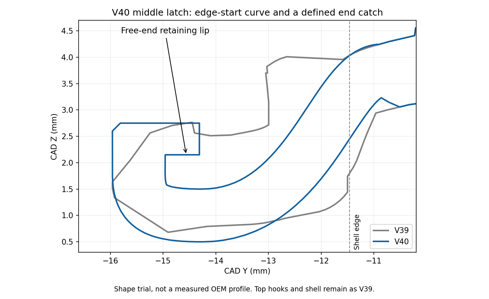

# V40 — edge-start curved middle latch with free-end catch

[Small cover test](Vader5Pro_V40_PLA_Curved_Middle_Latch_Test.3mf) · [All functional parts on ONE plate](Vader5Pro_V40_All_Parts_One_Plate_PLA.3mf) · [Separate-plate project](Vader5Pro_V40_PLA_Curved_Middle_Latch_Complete.3mf)

The owner reports V39's top clips now work, but the middle tongue curves too late, is tight in the opening and lacks an end catch. V40 changes **only the middle latch and its immediate root transition**. The top hooks, rounded shell, side lead-ins and reinforced anchor farther inside the shell retain V39 geometry within 0.01 mm sampled surface error.

The previous raised block/ramp below the shell rim is removed. A cubic centerline starts curving at the shell edge and is offset 0.50 mm each side to make a **nominal 1 mm normal wall**. The curved tongue turns upward at its free end and carries a distinct **0.65 mm back-facing overhang**, with a flat lower retaining shelf at CAD Z=2.15 mm. The cap is 0.60 mm tall, up to Z=2.75 mm, and has a small 0.15 mm outer entry chamfer. The old underside root step is blended away inside the first 0.95 mm of shell depth to avoid a pointed ledge beside the opening.

This shape follows the owner's description/photo qualitatively. No dimensioned OEM middle-hook profile is available: the curve controls, 1 mm wall and lip dimensions are trial choices. They do not establish an exact OEM replica, slot clearance or force.

| Dimension / feature | V40 |
| --- | --- |
| Middle tongue width | 5 mm, retained |
| Projection beyond shell rim | 4.5 mm, retained |
| Shell envelope | 35 × 24 mm, retained |
| Overall including middle tip | 28.5 mm, retained |
| Top pair | V39 geometry retained; owner reports it clips properly |
| Middle anchor | Positive-volume overlap with retained shell; one closed connected cover mesh |

## Print and fit

Start with the small cover test, estimated **44m 40s**. **Keep the saved side-print orientation**, 100% scale, custom supports and 5 mm contacting brims. Open as a project in Snapmaker Orca with **U1 standard 0.4 mm nozzle / Textured PEI Plate / regular Snapmaker black PLA**, mapped to the tool holding it.

Parameters remain 220°C nozzle, 65°C bed, 0.12 mm layers / 0.20 mm first, four walls, 25% gyroid, 8 mm³/s flow cap, 0.8 mm retraction at 30 mm/s, 2 mm wipe, 0.20 mm Z hop and PLA cooling. [Full inherited material settings](../v28_pla/README.md). Support gaps remain at least 0.16 mm by design for cover/mount, subject to layer quantization.

Let it cool before removing supports. Work from the support bases and do not pry against the curved tongue/end lip. Leave the latch and its solid root attached. Clear all support remnants from the undercut before trying it. Test unforced entry, seating and latching without a loaded box; stop if it catches, whitens or cracks. The new tongue is intended to flex differently from the prior block, but its physical strength, release force and fatigue life are untested.

The **one-plate project** prints the full mount, shared Box 2 and sliding lid together, estimated **2h 54m 42s**. Reuse good existing box/lid prints. The separate-plate project contains cover, mount, box, lid and optional stringing test on plates 1–5.

## Checks

[Middle profile, lip shelf and shell overlap](../../validation/v40_pla/middle_profile_checks.json) · [Native meshes/settings](../../validation/v40_pla/geometry_and_project_checks.json) · [Layer/support checks](../../validation/v40_pla/layer_islands.json) · [End-lip material/open-undercut toolpaths](../../validation/v40_pla/middle_lip_toolpaths.json) · [Planned lip footprint plot](../../preview/V40_Lip_Toolpath.png) · [Inside root extrusion](../../validation/v40_pla/middle_root_toolpaths.json) · [Unchanged top-shoulder paths](../../validation/v40_pla/hook_toolpath_checks.json) · [One-plate placement](../../validation/v40_pla/one_plate_checks.json) · [Separate-plate slice](../../validation/v40_pla/slice_result.json) · [One-plate slice](../../validation/v40_pla/one_plate_slice_result.json) · [Geometry builder](../../tools/build_v40_geometry.py)

Snapmaker Orca 2.4.1 projects are independently sliced. For sampled central latch layers, line-width footprints with round end caps estimate material in the lip and air beneath its retaining shelf. This checks planned deposition, not a measured print or actual controller capture. The root is positively overlapped with retained shell material, and cover/mount are each a closed connected mesh. Support gaps may trigger floating-region/cantilever warnings; inspect the preview. Use the Python builder's Manifold union for reproducible assembly; legacy CGAL import unions may fail on tolerances. No private user photos or scan imagery are published.
